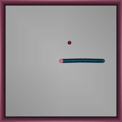

# liquid-policy-robustness

When a robot arm's sensors get noisy, does a liquid neural network keep controlling it
better than an ordinary network of the same size? This repo tests that claim on a
simulated two-joint arm. The networks have about the same number of parameters, each
one is trained five times, and all are scored on the same held-out episodes.

Status: started 2026-10-18. Steps 1 and 2 run. Step 3 waits on the predictions in
`NOTEBOOK.md`.



*The scripted teacher on three training episodes of Reacher-v5, top-down view at
half speed. Pink is the arm's base and red the target; the fingertip is the free end
of the arm.*

## Why this question

Liquid neural networks come from Ramin Hasani, Mathias Lechner and colleagues at TU
Wien, IST Austria and MIT; Hasani, Lechner, Alexander Amini and Daniela Rus went on to
found Liquid AI. Each neuron is a small differential equation whose time constant
changes with its input. The CfC (closed-form continuous-time) version replaces the
numerical solver with a closed-form approximation, which makes it fast enough to train
like an ordinary recurrent network.

The claim tested here comes from drone navigation. Liquid networks trained to imitate
a human pilot kept flying to the target in environments unlike their training data,
where the other networks the authors compared did worse (Chahine et al. 2023). Their
main test changed the scenery. They also added noise and lighting changes to recorded
camera frames offline, and report that the liquid networks' outputs drifted least.
This repo asks a closed-loop version of that question, on the arm's state readings
instead of camera images.

Two simpler explanations could produce the same effect, so the comparison controls for
both:

1. **Memory.** A network that remembers the last few steps can average noise away.
   An LSTM can also do that. If a liquid network beats the memoryless MLP but ties the
   LSTM, within a margin fixed before the run, the credit goes to memory, not to liquid
   neurons.
2. **Size.** A bigger network can simply fit better. Every network here has between
   4,816 and 4,994 parameters that can change its output.

Liquid AI's current products are a different design. Its LFM2 language models mix
short-range convolution blocks with attention blocks (the 350M-parameter text model
inside LFM2.5-VL-450M has 10 of the first and 6 of the second), and none use CfC
neurons. Step 5 fine-tunes one of those released models on the same arm.

## The setup

**Arm.** Gymnasium Reacher-v5 (MuJoCo), the same arm as
[robot-policy-evals](https://github.com/di-omics/robot-policy-evals). There are 10
observation numbers (joint angles as cos and sin, target position, joint speeds,
fingertip minus target) and 2 torques. An episode is 50 steps of 0.02 s.

**Teacher.** A scripted controller in `common.py`. It works out which way each joint
would move the fingertip toward the target (the arm's Jacobian, transposed), damps the
joint speeds, and pushes the elbow to bend while the arm is nearly straight, which is
where a pure Jacobian-transpose controller stalls. It is not perfect: it still ends
more than 2 cm from the target in about 6 of 100 evaluation episodes, so the mean
final distance is reported alongside the median and the 90th percentile. A teacher
that solves the arm's geometry exactly (inverse kinematics) never misses, but in an
early test, not included here, a small network imitated it much worse, so this repo
uses the Jacobian teacher.
Because no learning is involved, the teacher gives exact labels to imitate and a
reference line for the noise test.

**Students.** Four networks, each trained to copy the teacher's torques from the same
500 clean demonstration episodes (behavior cloning):

| name | what it is | parameters that can change the output |
|---|---|---|
| `mlp` | two hidden layers of 64, no memory | 4,994 |
| `lstm` | LSTM, 29 hidden units | 4,816 |
| `cfc` | CfC liquid network: one 40-unit input layer, then 22 fully connected liquid neurons | 4,974 |
| `ncp` | CfC neurons with sparse neural-circuit-policy wiring, 40 neurons | 4,986 (5,618 trainable, of which the wiring holds 632 at zero) |

Every network ends in a linear layer and a tanh, so each can output any torque the
teacher uses; `train.py` prints the largest torque each network produces and warns if
it falls short. `cfc` and `ncp` differ in more than wiring: `cfc` also has the 40-unit
input layer, so a gap between them is not a test of wiring alone. The wiring masks
only the main input weights of each layer; the time-constant gates and the
connections within a layer stay dense. All five `ncp` runs share one random wiring.

Every student gets the same optimizer, learning-rate schedule, batch size and 300
passes over the data, and keeps the weights with the lowest error on the validation
demonstrations. A shared budget is not the same as each network reaching its best
fit: compare the validation errors `train.py` prints before reading the noise curves.

**Test.** Every student and the teacher runs one episode on each of 100 held-out seeds
at each noise level. Gaussian noise is added to all 10 observation numbers, scaled by
each number's spread in the demonstrations: at sigma 1.0, the noise on each reading has
the same standard deviation as that reading has across the demonstrations. On a given
seed, every policy receives exactly the same noise draws. The score is the true
fingertip-to-target distance at the end of the episode, read from the simulator, never
from the noisy observation. `plot.py` draws mean and median final distance against
noise, and prints each network's difference from the LSTM with a 95% interval.

**Seeds.** Demonstrations come from seeds 0-499, model selection from 500-599, and every
reported number from 1000-1099. Intervals are taken across the five training runs of
each network, so they leave out the variation from using only these 100 evaluation
seeds.

## Plan

1. Scripted teacher and demonstrations. (`collect.py`)
2. Train the four students, five training runs each. (`train.py`)
3. Noise sweep, with the deciding number and the predictions written first.
   (`evaluate.py`, `plot.py`)
4. Take the result apart: add noise to one group of readings at a time (angles,
   speeds, target, fingertip offset); give the MLP an average of its last few
   observations, to test whether smoothing alone explains any advantage from memory;
   a CfC without the input layer; several `ncp` wirings; train with noise as well as
   test with it; more training runs wherever the intervals are too wide to decide.
5. Fine-tune Liquid AI's open vision-language model
   [LFM2.5-VL-450M](https://huggingface.co/LiquidAI/LFM2.5-VL-450M) to turn camera
   images of the same arm into torques, and test it with the same kind of noise applied
   to the images. It has 449 million parameters and ships Apple-silicon (MLX) builds;
   if the laptop is too slow, rent a GPU by the hour. Its license is the LFM Open
   License v1.0.
6. Write-up: what held, what did not, and what remains uncertain.

## Run it

Requires [uv](https://docs.astral.sh/uv/). Run from this folder:

```bash
uv run collect.py
```

```bash
uv run train.py --arch all --seeds 5
```

```bash
uv run evaluate.py
```

```bash
uv run plot.py
```

Training all 20 networks takes about 20 minutes on an M5 laptop CPU, mostly the two
liquid networks; evaluation takes about a minute. `evaluate.py` needs the one-line
TODO in `common.py` filled in first, and checks it before the sweep starts.

## References

- Hasani, Lechner, Amini, Rus, Grosu. Liquid time-constant networks. AAAI 2021.
- Lechner, Hasani, Amini, Henzinger, Rus, Grosu. Neural circuit policies enabling
  auditable autonomy. Nature Machine Intelligence, 2020.
- Hasani, Lechner, Amini, Liebenwein, Ray, Tschaikowski, Teschl, Rus. Closed-form
  continuous-time neural networks. Nature Machine Intelligence, 2022.
- Chahine, Hasani, Kao, Ray, Shubert, Lechner, Amini, Rus. Robust flight navigation out
  of distribution with liquid neural networks. Science Robotics, 2023.
- Correll. Liquid networks with mixture density heads for efficient imitation
  learning. [arXiv:2603.27058](https://arxiv.org/abs/2603.27058), 2026.
- The CfC and NCP implementations come from the
  [ncps](https://github.com/mlech26l/ncps) library.

## Notes

The lab notebook (`NOTEBOOK.md`) records each prediction before the run that tests
it. `robot-policy-evals` will train a policy on this arm with reinforcement learning
(Stable-Baselines3). This repo imitates a scripted teacher instead, so it does not
depend on that one.
